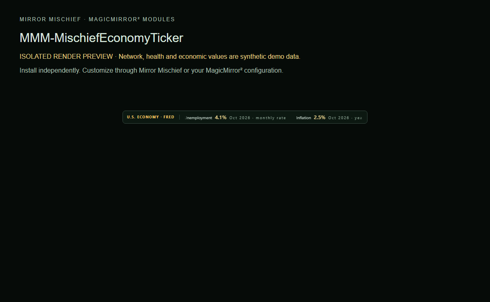

# MMM-MischiefEconomyTicker

A configurable ticker of official US economic releases from FRED.

Part of [Mirror Mischief](https://github.com/FoggEyez/Mirror-Mischief). Install and configure manually, or use the optional companion.



Screenshot uses the actual module renderer in an isolated preview. Network/health/economy readings are labelled synthetic demonstration data, not live readings.

## Install

Requires a working MagicMirror² installation, Node.js 22 or newer, and a current browser. Development baseline: MagicMirror² 2.38.0 API. Physical-device compatibility of this newly packaged version remains to be verified; see VALIDATION.md.

```sh
cd ~/MagicMirror/modules
git clone https://github.com/FoggEyez/MMM-MischiefEconomyTicker.git
```

No npm runtime dependencies or install scripts. Python 3 must be available as python3.

Add this to the modules array in config/config.js, then restart MagicMirror²:

```js
{
  module: "MMM-MischiefEconomyTicker",
  position: "bottom_bar",
  config: {}
}
```

## Customize

Install Python 3 (on Debian/Raspberry Pi OS: `sudo apt install python3`) before enabling. The helper invokes python3 with no pip packages. Shows US unemployment, inflation, payroll changes, GDP growth and interest rates when available. Period labels identify release dates; these are reported releases, not live market prices. `scrollSeconds` is clamped to 30–240. `placement: auto` follows native regions; fixed anchors deliberately override it. Saved data is retained after failed requests, labelled saved or overdue. The regenerable cache is ~/.cache/MMM-MischiefEconomyTicker/economy.json. Weather themes and owner layout installers are not dependencies.

All supported settings are visible as literal defaults for generated settings editors.

| Setting | Default | Type |
| --- | --- | --- |
| scrollSeconds | `90` | number |
| showPeriods | `true` | boolean |
| placement | `"auto"` | string |
| panelWidth | `600` | number |
| horizontalMargin | `12` | number |
| verticalMargin | `6` | number |
| offsetX | `0` | number |
| offsetY | `0` | number |
| textSize | `"normal"` | string |
| backgroundOpacity | `97` | number |

## Mirror Mischief companion

Part of [Mirror Mischief](https://github.com/FoggEyez/Mirror-Mischief), a companion designed to make module installation, settings and layout easier. See [MIRROR-MISCHIEF.md](MIRROR-MISCHIEF.md) for setup and availability.

In Mirror Mischief, choose Install from a link, paste this repository URL, then open Module settings. Set your preferences and position, save and run Check setup. The repository folder, JavaScript entry and Module.register name match exactly. companion.json describes supported placement and dependencies; the current companion reads defaults from JavaScript, not this manifest. One instance per mirror is supported in this release; helpers share one configuration per module. For renamed legacy modules, install this version turned off first and disable the legacy counterpart before enabling it. Moon and Quotes retain their existing names: back up and review any local changes before updating their existing folders. No automatic config migration or removal occurs. Ordinary MagicMirror² configuration works without the companion.

## APIs, privacy and cost

Public [FRED observations](https://fred.stlouisfed.org/) via its public CSV download; no API key or paid account. Uses BLS, BEA and Federal Reserve series. Refreshes every six hours, with backoff on failure; provider availability and terms apply. Internet and Python 3 are required.

No telemetry or analytics is added by Mischief. Keep private configuration, tokens and collector snapshots outside this repository.

## Update or remove

Review CHANGELOG.md, back up your private config and local customizations, then run git pull --ff-only inside this module folder and restart MagicMirror². To remove, disable/remove its config entry and restart; retain the folder for rollback or uninstall it using your companion. Never overwrite private configuration from an example.

## Development and support

Run npm ci and npm test. See CONTRIBUTING.md and VALIDATION.md. Report reproducible issues through this repository's Issues tab; remove secrets and private addresses.

## Credits and license

Original Mischief fetcher and display. Data supplied through FRED, Federal Reserve Bank of St. Louis; underlying series from BLS, BEA and the Federal Reserve. Data rights remain with their respective sources.

Original Mischief code: MIT, Copyright 2026 FoggEyez. Third-party licenses and data credits remain applicable; see THIRD_PARTY_NOTICES.md.
